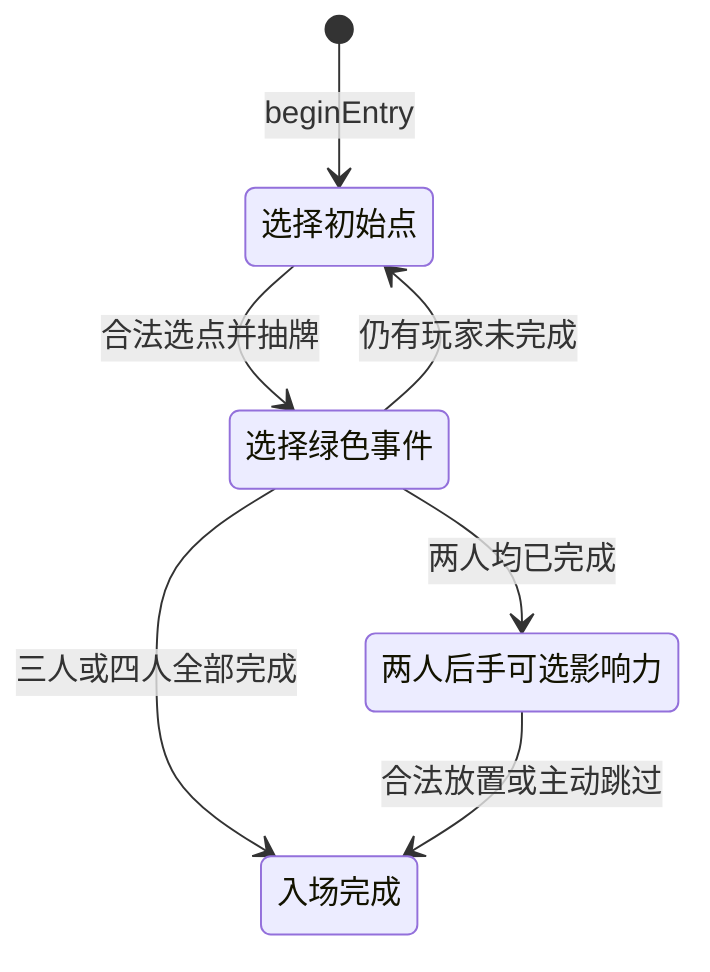

# 基础版入场流程实现

日期：2026-10-18。状态：两人、三人、四人入场内核已实现；没有联机服务或完整回合。实际运行记录见 [入场测试](testing/entry-validation-2026-10-18.md)。

## 规则来源与明确决定

| 规则 | 来源 | 实现 |
| --- | --- | --- |
| 用喜欢的方式确定起始玩家，之后顺时针行动 | 基础规则书印刷 p04 | 由可信服务端传入实际顺时针座位及已选先手；程序不代替玩家决定先手 |
| 每人依次选择不同的绿色初始资源点 | p04 | 校验已轮到该玩家、资源点可作初始点且未被占用 |
| 放城市，翻绿色事件、放对应资源标记，然后选一个选项 | p04 | 选点和选事件是两个指令，中间持久表示 pendingEvent；抽牌由服务端牌堆决定 |
| B-01 可以立即获得源岩/源石/异铁各 2 | p04 | 选择 B-01 时必须明确 claim 或 decline；其他点不能携带这个奖励选择 |
| 初始资金三人为 10/12/18，四人为 10/12/14/18 | p04–05 | 按实际入场顺序发放，在最后一个绿色事件完成时结算一次 |
| 两人以三人规则为基础，不能选择 B1 为初始点 | p23 | 使用三人地图与去掉四人牌的绿色牌堆，但初始选择明确排除 B-01 |
| 两人决定初始资源点后，非起始玩家可立即放 1 个影响力 | p23 | 两人的初始资源点步骤（含绿色事件）完成后，进入后手的可选放置阶段；可以选合法槽位或主动跳过 |
| 该放置沿用正常部署条件，没有相邻限制 | p05、p23 | 槽位必须为空；资源点须已探索且无其他玩家城市；可选择远处航道，不从图形坐标计算距离 |
| 两人初始资金为 10/18，后手另获 3 分 | p23 | 在可选影响力选择完成或跳过后发放；分数与金券分开 |
| 入场没有探索行动的路费与末尾影响力步骤 | p04 与 p06 探索的不同步骤 | 不套用探索行动收费或自动给初始点再放一个玩家标记 |

规则事实仍以用户规则书及已确认牌表为准；没有使用 p23 带 E 标识的企业规则，也没有引入《感染者》内容。

## 状态转换

完成只表示入场步骤完成，`phase` 仍为 entry。没有自动进入尚未实现的角色盖放、回合行动或采集阶段。

## 服务端与玩家输入的边界

`beginEntry` 是可信服务端初始化操作：接收 clockwisePlayerIds、startingPlayerId、expectedVersion。省略 greenDeckOrder 时，用 Node.js crypto.randomInt 做 Fisher–Yates 洗牌；只包含该人数可用的全部绿色牌，不因只用几张就缩小牌堆。

greenDeckOrder 是服务端测试/重放时的确定性配置，不能直接取自玩家请求。当前没有 NestJS/Socket.IO 适配器，也没有玩家可调用的设置牌堆接口。

`applyEntryCommand(state, definition, context, payload)` 分开接收：

- 可信 GameDefinition 和当前权威状态。
- `context.authenticatedPlayerId`：未来服务端认证层给出的玩家身份，不来自 payload。当前实现的是身份绑定校验，不是账号认证服务。
- 严格解析的 payload：gameId、expectedVersion、指令种类，以及节点 ID、选项 ID 或可选槽位。多余的 actorId、cardId、奖励/余额等字段会被拒绝。

玩家指令只有：

| type | 玩家选择 | 校验与执行 |
| --- | --- | --- |
| select-initial-node | nodeId；B-01 另需 b01Bonus | 当前玩家/阶段、合法初始点、两人禁选、占用和明确奖励决定；从牌堆头抽牌、放城市及资源标记，进入待选事件 |
| choose-green-event | choiceId | 只能选择当前 pendingEvent 所属牌的选项；执行已确认绿色牌的本人奖励，随后推进顺序或结算初始资金 |
| choose-entry-influence | slotId 或 null | 仅两人后手在 bonus-influence 阶段可用；null 明确跳过；实际放置从供应取 1 枚并保留全局守恒，然后完成入场 |

每个成功指令的状态版本加 1。对已返回的新状态重放旧请求会因版本不符被拒绝；即使使用最新版本，在 complete 状态也不能重复领取资金或奖励。

## 快照格式与恢复

- 既有 1.0.0 最小快照仍能解析，不擅自重写旧数据。
- `beginEntry` 只接受版本 0、无城市/资源标记/棋盘影响力、零余额及零分的原始入场前快照，并将输出格式升为 1.1.0。
- 1.1.0 必须包含 entry 进度，1.0.0 不得偷带进度；不允许通过漏掉进度而悄悄重置流程。
- entry 保存实际顺序、已完成玩家数、剩余绿色牌序和待选事件。pendingEvent 引用棋盘上已经放置的城市与资源标记；校验器检查引用一致，而不另存可独立修改的城市位置。
- 校验器验证玩家顺序、进度/阶段、选中城市、待选牌、剩余牌集合和两人额外影响力位置相互一致。已有标记归属/守恒与资源标记目录校验继续执行。
- JSON 序列化后可恢复 pendingEvent，继续处理选项；恢复本身不会重新抽牌或重复奖励。尚未实现数据库持久化或迁移服务。

1.1.0 是动态快照格式版本，不是项目发布版本；GameDefinition、地图和事件定义版本均未修改。

## 返回值与实际能力限制

转换在输入的解析副本上完成，成功后深度冻结。非法选择或数值溢出不会改动原始输入；同一指令内的城市/标记/奖励/版本变化作为一个返回快照处理，不撤销之前已完成的合法指令。

这是纯函数规则内核。实际服务器仍需在房间内串行处理或通过存储 compare-and-swap 提交版本；仅比较传入版本不代表已经实现跨进程并发控制或持久化幂等。

权威快照含未公开的 remainingGreenEventIds，未来网络层必须单独做公开状态投影，不能将完整快照直接广播给玩家。当前没有网络出口，因此没有声称已经实现隐藏信息同步。

绿色选项目前全为本人资源奖励，本轮实际执行全部 12 个绿色选项。黄色、红色的 37 个选项继续只有静态数据；费用、对手收益、特殊放置等完整事件执行仍待实现。角色、城市样式、完整回合、UI 与联机均未在本次开发。

## 同日后续实现

绿色事件奖励现复用 [基础事件结算核心](Event-Settlement-2026-10-18.md)；入场流程继续持有身份/版本、待选事件和推进逻辑。原 68 个入场测试及编译后的完整 2/3/4 人流程继续通过。本文件此前的 379 是入场增量验收结果，当前完整项目最新为 473；入场格式和规则未变。

[探索流程](Exploration-Flow-2026-10-18.md) 随后接入完整入场后的黄色/红色行动链路；入场快照仍为 1.1.0，明确进入探索才转为 1.2.0，并保留实际玩家顺序和绿色剩余牌。最新全项目验证为 553/553，原 68 个入场测试继续通过。

同日 [城市移动增量](City-Move-Flow-2026-10-18.md) 已完成。当前项目完整验证为 631/631，原入场 68 个用例继续通过；城市移动/探索转换保持实际玩家顺序和绿色剩余牌，不更改初始奖励及资金规则。
