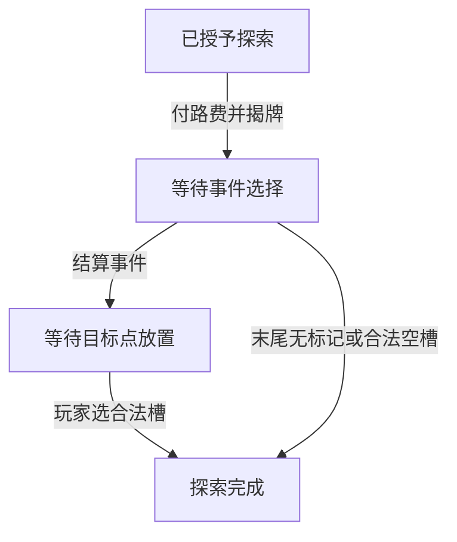

# 探索行动完整链路 · 2026-10-18

本模块将已完成的事件核心接入一次探索：校验目标与路径 → 支付路费 → 揭示资源标记并保存待选事件 → 玩家选择事件 → 独立处理目标点末尾影响力。支持完整入场后实际执行黄色、红色及剩余绿色牌，并从 JSON 快照恢复。

本增量实现探索执行器；[城市移动](City-Move-Flow-2026-10-18.md) 已随后实现。完整回合调度、角色盖放/快速行动、其他主要行动、采集/收尾和结束计分仍未实现。`complete` 代表这一次探索结束，不代表玩家所有快速行动结束或全局回合自动推进。

## 已核对依据

| 事项 | 来源与实现 |
| --- | --- |
| 探索三个步骤 | 基础规则书 p06：先付路费，再揭示/结算事件，最后在目标点放置影响力 |
| 从实际城市连接目标 | p06；请求使用逐步的航道 ID 与到达节点，不依赖坐标或替玩家选择路线 |
| 路费 | p06：有本人影响力免费；否则向该航道某个对手所有者付 2 金券，无玩家影响力则向供应堆付 2 |
| 分叉航道身份 | Accepted ADR-0001 与已核验地图：同一航道使用共享槽位和唯一身份，不拆边重复收费 |
| 红区开放 | p12/p23：四人第 4、三人第 5、两人第 6 回合开放；红区航道本身没有回合封锁 |
| 放置及尽量执行 | p05/p13：空槽、真实标记、资源点已探索且无对手城市；无法放置时保留已执行的费用与奖励 |
| 回合与行动授权边界 | p05：每回合 2 轮玩家行动，每轮 1 个主要行动，可前后做快速行动；本轮不假装已经实现这套调度 |

开发中重新读取最新源码、DevLog、ADR、地图清单及结算说明，并视觉复核基础规则书 p04–07、p12–13、p23。资料库检索没有命中单独的规则解释文件；未将《感染者》规则或企业扩展用于补全。这里采用基础原文明示的航道连接与目标限制，不另加“中间节点必须已探索”或“红区航道禁用”的条件。

## 服务端入口与玩家请求

源码：`packages/game-core/src/game/exploration.ts`、`exploration-rules.ts`、`exploration-invariants.ts`；从根包和 `/game` 导出。

`openExplorationWindow(state, definition, {actorId, roundNumber, expectedVersion, deckOrder?})` 是可信服务端集成入口，授予一次探索机会。调用方必须先确认实际回合、玩家、角色阶段及可用主要行动；`roundNumber` 是全局 1–8 回合编号，不是每回合的第 1/2 轮。

该入口只接受已完成入场或已完成的上一次探索或城市移动，检查玩家登记和预期版本，禁止回合倒退。首次可提供仅供服务端测试/初始化使用的黄色/红色完整牌序；默认使用 crypto 洗牌。绿色剩余牌序沿用真实入场结果。之后新授予机会不能重设牌序，不重新洗已存在牌堆。

尚未实现的回合模块必须负责决定何时调用此入口。此函数本身不验证顺时针轮转、主要行动额度、角色盖放或快速行动；不能把它作为玩家请求开放，也不能以它代替完整回合授权。

玩家入口 `applyExplorationCommand(state, definition, {authenticatedPlayerId}, payload)` 使用严格的三种请求：

- `explore`：`gameId`、`expectedVersion`、`nodeId`、`path`。每步为 `{routeId, toNodeId, payeePlayerId?}`。
- `choose-exploration-event`：对局/版本及 `choice: {choiceId, costDecision?, influenceSlotId?}`。
- `place-exploration-influence`：对局/版本及 `slotId`，只允许本次探索目标点的合法槽。

玩家不能提交 actorId、回合、牌号、牌序、奖励或计算好的路费。身份来自可信适配层，仍待实现实际账号认证。每次成功请求只推进一个全局 stateVersion；过期版本、越权、越阶段、额外字段及异局请求均拒绝。生产存储仍需 CAS/事务，当前没有跨进程并发保障。

## 路径与支付

`getExplorationTollQuote` 从实际城市验证一段连续的“节点—航道—节点”行走；每步两个不同端点均须属于同一独立航道，最终端点必须是选定目标。请求每次最多 22 步，这是当前 DTO 边界；同一航道在行走中再次出现仍只按其唯一 ID 计费，不拆分三/四端航道。

路费按行动开始时槽位重新计算。对手拥有者只有一人时可以省略收款人；有多人时必须由玩家明确选择其中一人。免费航道/付供应堆航道不能附带玩家收款人，同一航道重复出现时不能指定互相冲突的收款人。

费用必须在本次事件奖励之前足额支付。扣除者、收款人余额及安全整数边界均检查；不足额不揭牌、不部分支付。报价是只读结果，不是另一份持久化路费事实，也不自动选择最短路线。

## 待选事件与末尾影响力

揭牌时从对应牌堆取首张，放置完全匹配该牌的资源指示物并保存节点/牌 ID；不会提前采集该资源。事件选择调用既有结算核心，不能指定另一张牌的选项。失败请求保留已经支付路费的待选快照；玩家可重新选择合法选项，不重抽牌、不再次扣路费。

事件额外影响力与探索末尾放置分开。结算完成后，依据更新后的槽位和库存重新计算末尾可放位置：有目标时要求玩家选择；无目标或标记不足则自动完成探索，保留事件奖励、已付费用及已放标记。例如 Y05 把目标最后一格占满，或事件用掉最后一枚标记，均不撤销前面的结算。

`getPendingExplorationChoiceRequirements` 与 `getExplorationFinalSlotIds` 提供当前步骤的可选项。恢复 JSON 后继续从保存阶段执行，不允许重选已完成的事件或由玩家自发开启下一次探索。

## 格式与校验

仅明确转换到探索时使用 GameState 格式 **1.2.0**：保留原有唯一棋盘/玩家/供应事实，新增 `exploration`、`eventDecks`，把真实入场的顺时针/起始顺序移到 `playerOrder`；删除已经结束的 `entry` 进度。之后继续保留该顺序，不丢失实际先手信息。没有把库存或棋盘复制为第二套权威状态。

旧 1.0.0/1.1.0 入场格式继续兼容，解析不会静默升级或重置。1.2.0 要求 exploration phase、进度、牌堆和玩家顺序成套存在；逐项核对剩余牌恰好为人数允许且尚未揭示的牌，禁止缺牌、重复、四人牌混入、揭示牌返回牌堆、城市缺失、错误待选牌/选项及非法阶段。格式/结构校验不证明完整历史或服务端授权来源，因此只接收可信权威状态。

GameDefinition、地图及事件定义版本/摘要、已确认文案与数值、ADR 决策、依赖和项目 0.2.0 版本不变。权威快照含剩余隐藏牌序，不可直接广播客户端；公开投影仍待实现。

## 下一步

按 [实际测试记录](testing/exploration-validation-2026-10-18.md) 复现。城市移动已接入相同待选事件/末尾放置模式，后续完善其他行动与完整回合授权；未提供的角色/城市样式效果继续保持未实现。没有 UI、网络服务、持久化事务、部署或发布。

## 城市移动共存补充

城市移动首次授予时使用 1.3.0。再切回探索时保持 1.3.0，删除已结束的 cityMove 进度，继续沿用同一牌堆和 playerOrder。直接由入场开启探索仍可使用原 1.2.0；解析旧存档不会静默升级。共用内部行动准备与局面校验不改变原探索 API、规则或内容摘要；原 80 个探索测试继续通过。
